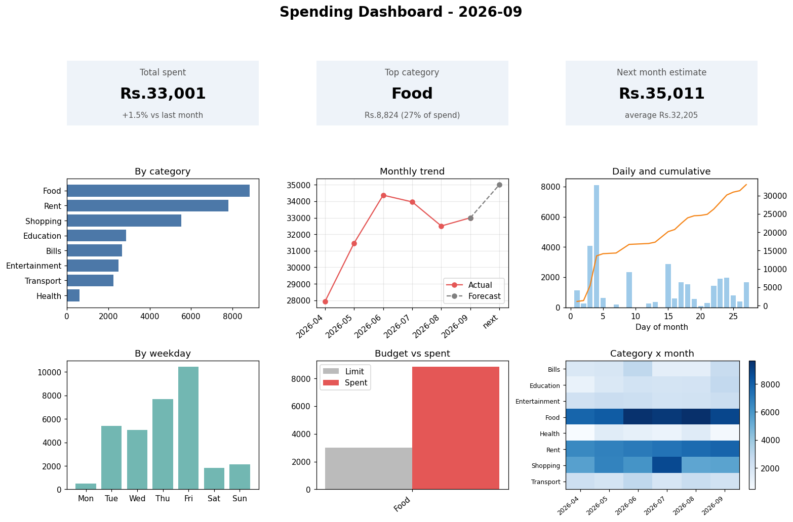

# Smart Spending Pattern Analyzer

A menu-driven Python application that shows where your money goes. You enter expenses by hand (no bank connection needed), and the app analyzes them by category and month, forecasts next month's spending, tracks budget limits, and draws a dashboard.

## Project Overview

Most people cannot say where last month's money went. This project turns a plain list of expenses into clear answers: which category costs the most, how spending changed since last month, what next month will probably cost, and which budgets were broken.

The code is mostly plain Python (classes, dictionaries, generators, decorators, file handling). pandas is used in one method and numpy in one method, only where they save real effort.

## Features

- Add, view, search and delete expenses (saved automatically to CSV)
- Recurring expenses (rent, subscriptions) that repeat every N months
- Monthly summary: totals, top category, average, median, biggest five expenses
- Month comparison: category-wise change in Rs. and %
- Forecast for next month using three methods (average of all months, average of last 3 months, numpy trend line)
- Budget limits per category with OK, WARNING or OVER status
- Unusual-spend detection (amounts far above a category's normal)
- Dashboard with 3 KPI cards and 6 charts (category, monthly trend, daily and cumulative, weekday, budget vs spent, category by month heatmap)
- Monthly text report export
- Input validation, safe saving, error logging and 10 unit tests

## Tech Stack

| Area | Tools |
|---|---|
| Language | Python 3.10 or newer |
| Core | csv, json, datetime, dataclasses, collections, statistics, heapq, itertools, functools, contextlib, logging, unittest |
| Data analysis (light) | pandas (one pivot table), numpy (one trend line) |
| Charts | matplotlib |
| Storage | CSV and JSON files |

## Setup and Run

1. Install Python 3.10 or newer.
2. Open a terminal in the project folder (the folder containing `main.py`).
3. Install the libraries:

```
python -m pip install -r requirements.txt
```

4. Run the app:

```
python main.py
```

5. Run the tests:

```
python -m unittest -v
```

### Menu

```
 1 Add expense      2 Add recurring    3 View          4 Search      5 Delete
 6 Summary          7 Compare months   8 Forecast      9 Budget     10 Unusual spends
 D Dashboard        E Export report    0 Exit
```

Quick demo: type `6` then `2026-09` for a summary, `8` for the forecast, and `D` then `2026-09` to open the dashboard.

## Environment Variables

None required.

## API and Database Notes

No API and no database. Data is stored in plain files:

- `data/expenses.csv` holds all expenses (sample data for April to September 2026 is included)
- `data/budget.json` holds budget limits (created when you set a limit)
- `reports/` holds exported text reports
- `charts/` holds saved dashboard images (see `charts/sample_dashboard.png`)

## Project Structure

| File | Job |
|---|---|
| `main.py` | Menu and program flow |
| `models.py` | Expense, RecurringExpense, ExpenseBook, Budget |
| `analyzer.py` | All calculations and the forecast |
| `charts.py` | Dashboard drawing |
| `reports.py` | Text report |
| `file_handler.py` | CSV and JSON reading and safe writing |
| `utils.py` | Input checks, date maths, decorators, logging |
| `test_spending.py` | 10 unit tests |

## Dashboard



## Team Member Contributions

| Member | Contribution |
|---|---|
| Praween | Project design, OOP models, analysis and forecast logic, file handling, dashboard, testing and documentation |
